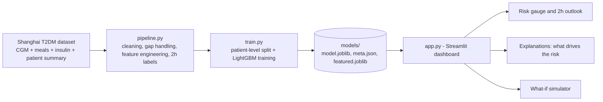

# 🩸 Glucose Twin

**A virtual patient that predicts whether blood glucose will rise above 180 mg/dL in the next 2 hours.**

Built at **National Institute of Technology (NIT) Jamshedpur**.

---

## 👥 Team

| Name | Institute |
|------|-----------|
| Yash Chawla | NIT Jamshedpur |
| Piu Chatterjee | NIT Jamshedpur |

---

## 📌 Project Title

**Glucose Twin: An Explainable AI Digital Twin for Predicting Post-Meal Glucose Spikes in Type 2 Diabetes**

---

## ❗ Problem Statement

People with type 2 diabetes often experience glucose spikes after meals or during the day. Sustained high glucose (above 180 mg/dL) raises the risk of long-term complications such as heart, kidney, nerve and eye disease. Continuous glucose monitors (CGMs) show what glucose is *now*, but they do not tell the patient what is *likely to happen next*. By the time a spike is visible, it is too late to act.

Most existing tools also act as black boxes: they give a number without explaining why, and they do not let a patient or clinician test "what if" scenarios.

**Our goal:** predict, from past data only, whether a patient's glucose will exceed 180 mg/dL within the next 2 hours, explain the reasons behind each prediction, and let users explore what-if changes.

---

## 🏥 Healthcare Use Case

- **Early warning for patients:** a heads-up before a spike so they can adjust a meal, take a walk, or follow their care plan.
- **Support for clinicians:** a quick view of a patient's glucose pattern, risk level and the factors driving it, to aid review and counselling.
- **Education and self-management:** the what-if sliders show how current glucose, recent trend and time since the last meal change the risk.
- **Remote care and research:** a prototype that could plug into CGM-based remote monitoring programmes.

> ⚠️ **Research prototype. Not a medical device and not for treatment decisions.**

---

## ✨ Features

- 2-hour-ahead spike prediction (glucose > 180 mg/dL) from CGM, meal and insulin data
- Patient profile used as extra context (age, BMI, diabetes duration, HbA1c where available)
- Interactive dashboard: glucose trace, risk gauge, snapshot tiles
- Explainability: per-prediction factors showing what pushes risk up or down
- What-if simulator: change current glucose, 1-hour trend and time since last meal
- Honest evaluation: patient-level train/validation/test split, compared against a "current glucose only" baseline

---

## 🛠️ Tech Stack

| Layer | Tools |
|-------|-------|
| Language | Python 3 |
| Data handling | pandas, NumPy, openpyxl, xlrd |
| Machine learning | LightGBM, scikit-learn |
| Model storage | joblib |
| Interface | Streamlit (custom CSS theme and `.streamlit/config.toml`) |
| Visualisation | Plotly |
| Dataset | Shanghai T2DM CGM dataset (CGM readings, meals, insulin, patient summary) |

---

## 🤖 AI/ML Model and Framework

- **Model:** LightGBM gradient-boosted decision trees (binary classifier). Falls back to scikit-learn `HistGradientBoostingClassifier` if LightGBM is not installed.
- **Target:** will glucose go above 180 mg/dL at any point in the next 8 readings (2 hours at 15-minute resolution)?
- **Features (built from past data only):**
  - current glucose, 15/30/60-minute changes
  - rolling mean, variability, peak and lowest over 1 h, 2 h and 4 h
  - meals in the last 2 h, hours since last meal, insulin in the last 2 h
  - time of day (sine/cosine)
  - patient profile from the summary file
- **Data preparation:** unit conversion (mmol/L to mg/dL), gaps up to 30 min filled, recordings split at longer gaps.
- **Evaluation:** patients in train, validation and test sets never overlap. Metrics: PR-AUC, ROC-AUC, precision, recall, F1. A baseline using only current glucose is reported alongside the model.
- **Explainability:** per-prediction feature contributions from the LightGBM booster, plus global feature importance.

---

## 🏗️ Architecture

📄 **Architecture diagram (PDF):** included in the repo, see [Glucose_Twin_Architecture_Diagram.pdf](Glucose_Twin_Architecture_Diagram.pdf)

Simplified view of the same pipeline:



---

## 📑 Presentation

📄 **PPT (PDF format):** included in the repo, see [Glucose_Twin_Final.pdf](Glucose_Twin_Final.pdf)
Simplified view of the same pipeline:


---

## 🎥 Demo Video

▶️ **Watch the 15–20 minute walkthrough on YouTube:** [https://youtu.be/nNBSjTgRb2I](https://youtu.be/nNBSjTgRb2I)

---

## 📑 Presentation

📄 **PPT (PDF format):** [Glucose_Twin_Final.pdf](docs/Glucose_Twin_Final.pdf)

---

## 📂 Repository Structure

```
Glucose_twin_NITJSR/
├── app.py                 # Streamlit interface
├── pipeline.py            # data loading, cleaning, features, labels
├── train.py               # training and evaluation
├── make_demo_data.py      # synthetic data for testing the app only
├── requirements.txt
├── .streamlit/
│   └── config.toml        # purple / white / blue theme
├── docs/
│   ├── Glucose_Twin_Final.pdf                  # presentation (PDF)
│   └── Glucose_Twin_Architecture_Diagram.pdf   # architecture diagram (PDF)
├── LICENSE
└── README.md
```

---

## 🚀 How to Run

1. **Clone the repository**
   ```bash
   git clone https://github.com/Piuu-17/Glucose_twin_NITJSR.git
   cd Glucose_twin_NITJSR
   ```
2. **Install dependencies**
   ```bash
   pip install -r requirements.txt
   ```
3. **Add the data** in `data/`:
   ```
   data/Shanghai_T2DM/                 <- the CGM files
   data/Shanghai_T2DM_Summary.xlsx
   ```
4. **Train the model**
   ```bash
   python train.py --data data
   ```
5. **Start the app**
   ```bash
   streamlit run app.py
   ```
   Open `http://localhost:8501` in your browser.

**Quick test without real data** (synthetic, never report these scores):
```bash
python make_demo_data.py
python train.py --data data_demo
streamlit run app.py
```

---

## 📊 Dataset

Shanghai T2DM CGM dataset: continuous glucose readings, meal and insulin records, and a patient summary file. Please download it from its original public source and follow its terms of use.

---

## ⚖️ Open Source License

This project is released under the **MIT License**. See the [LICENSE](LICENSE) file for the full text.

The dataset and third-party libraries (Streamlit, LightGBM, scikit-learn, pandas, NumPy, Plotly) keep their own licenses.

---

## ⚠️ Disclaimer

Glucose Twin is a research and educational prototype. The dataset is small and from one region, so results may not generalise. It must not be used for diagnosis, treatment or insulin-dosing decisions. Always follow the advice of a qualified healthcare professional.

---

## 🙏 Acknowledgements

NIT Jamshedpur, the creators of the Shanghai T2DM dataset, and the open-source community behind the libraries used in this project.
